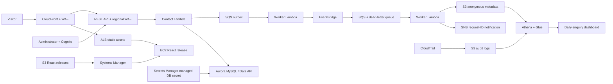

# Architecture

WAF protects CloudFront and direct API calls with managed rules and IP rate limits.
The ALB accepts the CloudFront origin-facing prefix list. EC2 accepts only its ALB.
No inbound SSH; EC2 uses IMDSv2, encrypted EBS and an instance role.
Static assets use HTTP from CloudFront to ALB; customer details use the HTTPS API.
Aurora uses isolated subnets, encrypted storage and no inbound SQL access.
Its existing RDS-managed Secrets Manager secret authenticates Data API access.

The API validates fields, binds SQL parameters and inserts a UUID-keyed contact row.
It then queues only non-personal metadata. A 202 means both operations succeeded.
Queue failure returns 503; the form retains the request ID for retry.
SQL and queueing are separate operations: see operations.md for reconciliation limits.
Notifications are at-least-once; duplicate SNS alerts can occur.
The service does not automatically phone customers; agents respond to notifications.
